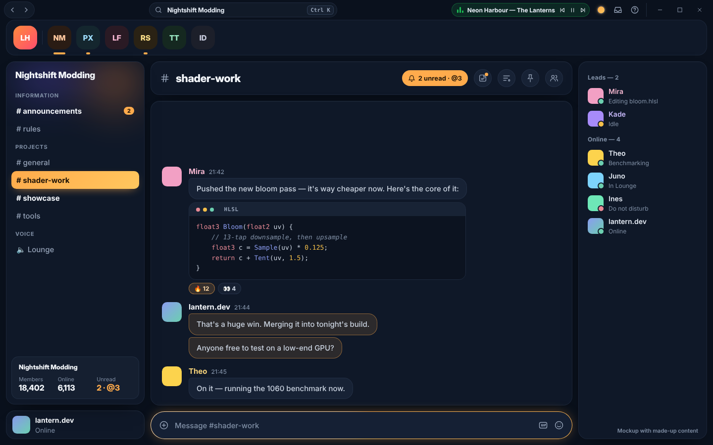
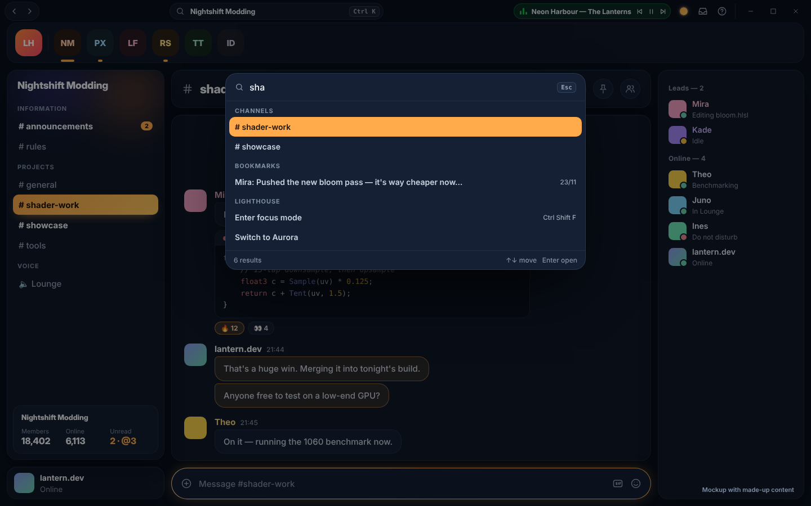
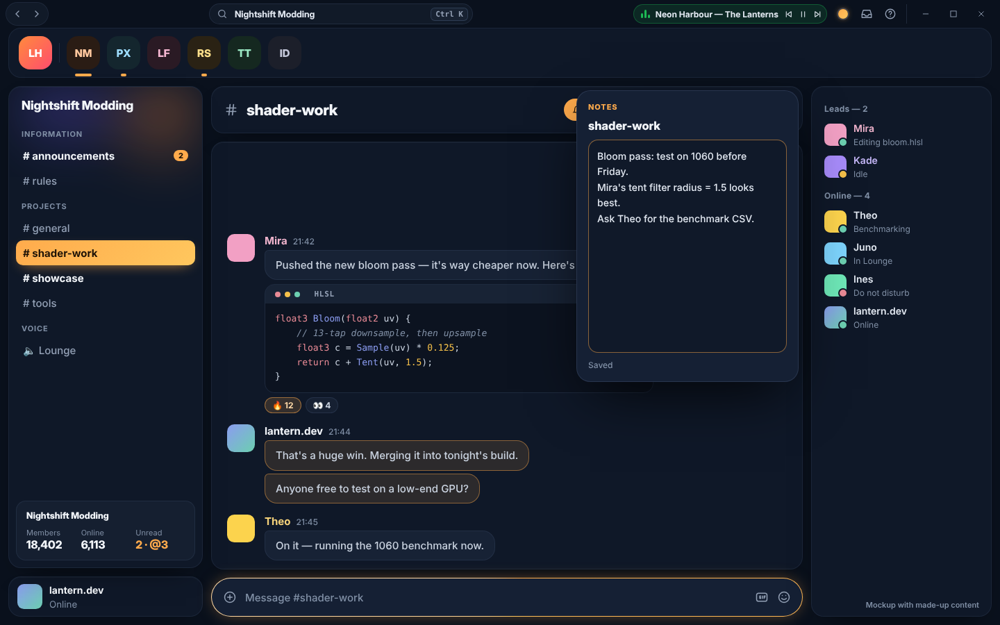
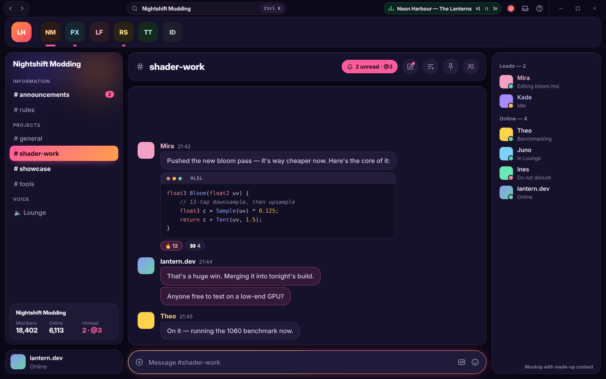
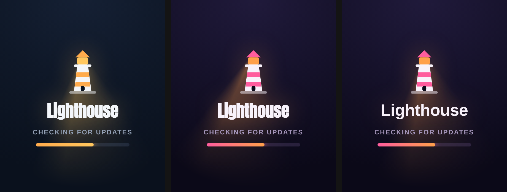

# Lighthouse

A SimForge-style theme for [BetterDiscord](https://betterdiscord.app): deep navy, warm amber accents, floating cards, chat bubbles, square avatars and a server strip across the top. A companion plugin adds a settings window and extra features.

| Command palette (Ctrl+K) | Channel notes |
|---|---|
|  |  |

| Leonida colourway | Start-up screens (SimForge, Leonida) |
|---|---|
|  |  |

Previews are mockups with made-up content.

## Install

1. Download `Lighthouse.theme.css` into your BetterDiscord **themes** folder.
2. Download `LighthouseSettings.plugin.js` into your BetterDiscord **plugins** folder.
3. Turn both on in Discord: Settings → Themes and Settings → Plugins.

The theme file is a small loader. It pulls `lighthouse.css` from this repo's GitHub Pages site every time Discord starts, so theme updates arrive by themselves. The plugin checks this repo for a newer version and asks before installing it.

## What's in it

- **Look:** SimForge navy and amber, floating cards, dashboard channel header, modern title bar, chat bubbles, square avatars, editor-style code blocks, restyled settings, menus, tooltips, pickers, friends page, calls and forums.
- **Plugin features:** matching icon set, channel notes, message bookmarks, Spotify buttons, shareable setup codes, breakage alerts, what's-new card, command palette (Ctrl+K), focus mode (Ctrl+Shift+F), shortcut sheet (Ctrl+Shift+/), title bar search pill, colourway dot and quick picker, now-playing pill, server overview card, unread pill, friend request banner, auto-collapsing sidebars, per-server, per-channel and time-of-day accents, card edge glow, settings profiles, accessibility mode, 8 colourways including the Daylight light mode.

## LighthouseBoost (optional)

A separate plugin that makes Discord lighter. It works with any theme.

- Pauses animations and chat GIFs while Discord is in the background. Calls, streams and stages keep playing.
- Frees memory when you've been away for a while.
- Turns off frosted-glass blur, the most expensive effect to draw.
- Optional: no animations, skip drawing off-screen messages, hide shop and upsells, hide Active Now.
- Deep optimisations: freezes animated profile cosmetics, cheaper chat and member-list layout, collapses huge stage audiences, and can unload the member list in giant servers.
- Lag meter: memory, frame rate, freezes per minute and channel-switch time, plus a "Free memory now" button.

Install it like the main plugin: put `LighthouseBoost.plugin.js` in your plugins folder and turn it on.

## Tune-up script (Windows, optional)

`tools/Lighthouse-Tuneup.ps1` speeds up the Discord app itself:

- Installs [OpenAsar](https://github.com/GooseMod/OpenAsar), an open-source rewrite of Discord's start-up layer, with its performance mode on. It keeps your original file as a backup.
- Sets Windows to run Discord on your high-performance graphics card.
- Offers to delete old Discord versions left on disk.

Right-click it and choose **Run with PowerShell**. To undo, run it with `-Undo`. Run it again after a big Discord update.

## Launch boost (Windows, optional)

`tools/Lighthouse-Launch.ps1` starts Discord with faster settings for its built-in browser engine: drawing on your graphics card, and no background throttling of calls and stages. It changes your Discord shortcuts and start-with-Windows entry only. It doesn't touch Discord's files. Run it with `-Light` to keep background throttling, or `-Undo` to remove it.

## Optimise the Discord app (Windows)

`tools/Lighthouse-Optimise.ps1` speeds up the Discord app itself, without plugins or OpenAsar. It asks before each step:

1. Clears bloated web and shader caches.
2. Deletes old Discord versions.
3. Runs Discord on your high-performance graphics card.
4. Stops Windows power-throttling Discord in the background, so stages and calls don't stutter.
5. Optionally gives Discord above-normal CPU priority.
6. Starts Discord with faster browser-engine settings (this includes everything the launch boost does).

Right-click it and choose **Run with PowerShell**. Use `-Undo` to reverse it all. Run it again after a big Discord update.

## Credits

- Base: [midnight](https://github.com/refact0r/midnight-discord) by refact0r (MIT), loaded remotely.
- Top server strip adapted from [Horizontal Server List](https://github.com/DiscordStyles/HorizontalServerList) by Gibbu (MIT).
